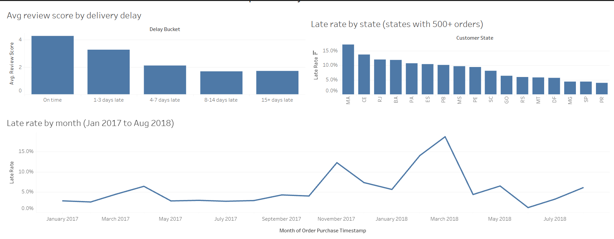

# Late Deliveries and Customer Reviews: Olist Marketplace Analysis

**Business question:** Do late deliveries hurt customer reviews, where and when do they happen, and what does it mean for the business?

**Live dashboard:** [View the interactive dashboard on Tableau Public](https://public.tableau.com/views/OlistDeliveryAnalysis_17947354930800/DeliveryAnalysis)

## Data

[Brazilian E-Commerce Public Dataset by Olist](https://www.kaggle.com/datasets/olistbr/brazilian-ecommerce) (Kaggle). About 100,000 anonymized orders from 2016 to 2018. Tables used: orders, order items, customers, reviews.

## Tools

Python (pandas, matplotlib) in Google Colab for cleaning and analysis. Tableau Public for the dashboard.

## Method

1. Kept only delivered orders that have a delivery date and a review (95,824 orders).
2. Calculated delay in days (actual delivery date minus the promised date) and flagged orders as late or on time.
3. Kept the latest review per order, then compared review scores, 1-star rates, revenue, states, months and repeat purchases.
4. In the state view, kept only states with at least 500 orders so tiny samples don't distort the rates. Months at the start and end of the data with very few orders were also excluded from the monthly trend.

## Key findings

1. **Lateness hurts reviews sharply.** On-time orders average 4.29 stars. Late orders average 2.27.
2. **Even short delays cost about a star.** Average score by delay: on time 4.29, 1-3 days late 3.29, 4-7 days 2.10, 8-14 days 1.67, 15+ days 1.72.
3. **Late orders get far more 1-star reviews.** 53.8% of late orders receive 1 star, compared with 6.6% of on-time orders.
4. **Only 6.7% of orders arrive late**, but they carry about 7.3% of delivered revenue (953K of 13.1M, in Brazilian reais).
5. **Some states are much worse.** Late rates: Maranhao (MA) 17.1%, Ceara (CE) 13.7%, Rio de Janeiro (RJ) 11.9%, Bahia (BA) 11.9%.
6. **Rio de Janeiro matters most by volume.** With 12,211 orders, it has roughly 1,450 late orders, more than any other state in the top 10.
7. **Late rates spike in certain months.** 12.3% in Nov 2017 (orders jumped about 63% from the previous month) and 18.7% in Mar 2018, when order volume was steady, so that spike points to something other than demand.
8. **Repeat purchasing is very low.** Only 3.0% of 92,747 customers ordered more than once.
9. **Lateness is not the main driver of low repeat purchases.** Customers whose first order was late came back 2.6% of the time, versus 3.0% when it was on time, a small gap.

## Recommendations

- Set more realistic delivery promises, and warn customers early when an order is at risk, since even 1-3 days late costs about one star.
- Prioritize logistics improvements in Rio de Janeiro (volume) and Maranhao and Ceara (worst rates).
- Investigate the Feb to Mar 2018 spike, which volume alone does not explain.
- Treat retention as a separate problem (follow-up offers, second-order incentives), because fixing delivery alone is unlikely to raise repeat purchases much.

## Limitations

- This shows association, not proof that lateness alone causes bad reviews. Other factors (product quality, seller behavior) are not controlled for.
- The reasons for the state and month patterns are hypotheses, not findings. The data does not explain them.
- Only customers who left a review are included, so unhappy or happy customers who did not review are missing.
- The difference in repeat purchase rate (2.6% vs 3.0%) was not tested for statistical significance.

## Files

- `olist_delivery_analysis.ipynb`: full analysis notebook
- `dashboard.png`: dashboard screenshot

The raw data is not included. Download it from the Kaggle link above.
